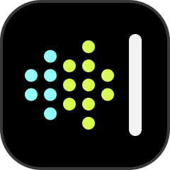
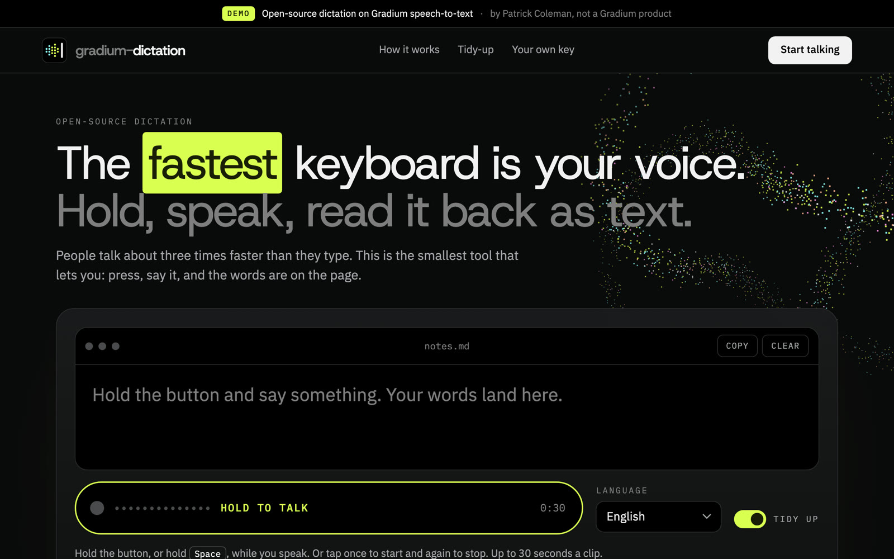

# gradium-dictation

Hold a key, speak, release: your words land in whatever app you're in. It's an
open-source, push-to-talk dictation tool on
[Gradium](https://gradium.ai) speech-to-text, in the spirit of Wispr Flow.

> **Status: first draft.** Two parts: the desktop tool in `desktop/` (its unit
> tests pass; it has not yet been run against a live Gradium key or a real
> microphone, see "Before the demo") and a web demo at the repository's root.

## Try it

```bash
pipx install "git+https://github.com/patrickscoleman/gradium-dictation#subdirectory=desktop"   # or: uv tool install …
export GRADIUM_API_KEY=gd_...       # free key at https://gradium.ai
dictate listen                      # hold right Option, speak, release
```

Other ways to run it:

```bash
dictate --language fr listen --key f8   # French, push-to-talk on F8
dictate listen --print                  # print the text instead of pasting it
dictate file meeting.wav                # transcribe a WAV file
```

**macOS permissions.** The first run asks for Microphone access. Then add your
terminal (or the installed app) under System Settings › Privacy & Security ›
**Accessibility** and **Input Monitoring**, so it can see the hotkey and paste.

Languages: English, French, German, Spanish and Portuguese, the five Gradium
speech-to-text supports.

## Web demo

The repository's root is the same idea in a browser, for trying it without
installing anything: press the button, speak, and read the text. It is a
static page (`public/`) and two small functions (`api/`, `lib/`), which
Vercel deploys as they are on every push to `main`.



- **What it does:** hold the button (or the space bar), speak, let go. The
  text arrives, the tidy-up takes out ums and doubled words (rules, not a
  rewrite; one switch shows exactly what was heard), and the page works out
  your words a minute against the average typist's 52.
- **Run it here:** `GRADIUM_API_KEY=gd_... node dev.mjs`, then open
  http://127.0.0.1:4173. Leave the key out and paste one into the page instead.
  `node --test` runs its tests.
- **The key stays on the server.** The page records a clip of up to 30 seconds
  as 16 kHz WAV and posts it to `/api/transcribe`, which calls Gradium's REST
  speech-to-text and streams the words back. A visitor can paste their own
  key instead: it is passed to Gradium for that request and kept nowhere.
- **What the shared key can spend.** Gradium bills speech-to-text at 3 credits
  a second. The shared key gives everybody together 30 minutes a day (5,400
  credits: about 29 cents at the XS plan's own rate, 38 cents at its top-up
  rate), one address 5 minutes a day and 8 clips in 10 minutes. Past that
  the page says "Demo paused for today". It also stops whenever the account
  has fewer than 120,000 credits left, by Gradium's own count, so a lost
  counter cannot run the account down. The numbers are in `lib/config.js`.
- **Where the counts live:** Vercel's Runtime Cache, in the one region the
  functions run in (Paris). Nothing to set up. An address is kept only as a
  hash salted with the day.
- **What it keeps:** no audio, no text, no cookies. Every page is `noindex`.

To deploy: import this repository in Vercel with its default settings and
add `GRADIUM_API_KEY` as a Production environment variable (`vercel.json`
says the rest). Without the key the page still works for anyone who pastes
their own.

This is a demo by Patrick Coleman, not a Gradium product.

## How the desktop tool works

```
hold key ─▶ mic, 24 kHz PCM, 80 ms chunks ─▶ Gradium STT stream
release  ─▶ end of audio ─▶ last words flushed ─▶ tidy text ─▶ paste into the focused app
```

The code is in `desktop/src/dictate/`.

- `audio.py` streams the microphone while the key is held.
- `transcribe.py` sends it to Gradium's realtime STT. The text streams back
  while you speak, so little is left to wait for after you release.
- `text.py` joins the segments and tidies spaces and capitals.
- `insert.py` pastes through the clipboard, then restores what was there.
- `hotkey.py` is the push-to-talk state machine. It ignores key auto-repeat.

Each dictation prints the time from key release to text, so you can see the
latency.

## Before the demo

1. Run `dictate file` on a short WAV recording with a real key. Check how
   segments join: `text.py` assumes each segment is a word or phrase.
2. Run `dictate listen --print` and read the release-to-text time. Try
   `json_config` `delay_in_frames` (7 to 48 frames of 80 ms) to trade
   accuracy for speed.
3. Then try `dictate listen` in Notes, Slack and a browser.

## Next

- **Personal dictionary.** Gradium's keyword boosting (`keyword_boost_id`),
  for names and jargon.
- **Clean-up pass.** Remove filler words, add punctuation and formatting by app
  (email, chat, code), with an optional LLM.
- **Hands-free mode.** Gradium's semantic voice activity detection (an
  `inactivity_prob` every 80 ms) ends a dictation without a key.
- **A menu bar app**, with a sound and a level meter while recording, and a
  signed macOS build.
- **Streaming insert**, typing text live as it arrives.
- **Live text in the web demo**, over Gradium's WebSocket with short-lived
  tokens, for visitors on their own key.
- **A real clean-up pass in the web demo**: today's tidy-up is rules (ums,
  doubled words, capitals); rephrasing and formatting need a language model.

## The mark

`assets/logo.svg`: a voice, as columns of dots, arriving at a text cursor.
Original artwork for this project, under the same licence. It is not a
Gradium logo, and this is not a Gradium product.

## License

MIT
